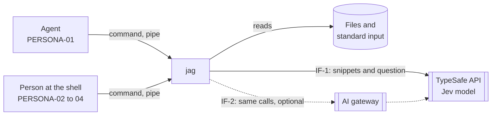
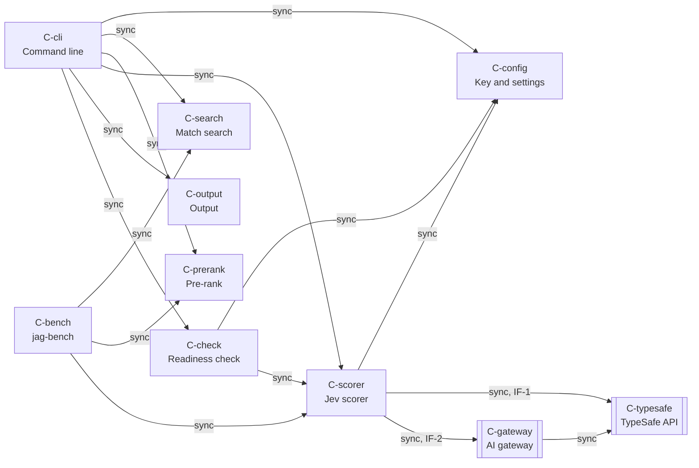

# jag system design

## Summary

jag is one Rust binary that runs on the machine of the user. It finds the
lines that match a term with the ripgrep libraries, pre-ranks them with BM25
on the question words, and scores the top 200 with the Jev model of the
TypeSafe API. It writes the best results as text or as one JSON document,
within a size limit. jag keeps no data between searches and has no server.

The quality priorities, in order:

1. The top results answer the question (QS-1).
2. jag says when nothing answers (QS-2).
3. A typical search is fast (QS-3).
4. jag fails clearly and fast when the model service is down (QS-4).
5. The key stays secret (QS-5).

Key decisions:

- Find the matches with the ripgrep libraries, because they are fast and
  their skip rules are the skip rules of rg (0001-find-matches-with-the-ripgrep-libraries.md).
- Score 200 results in calls of 32, six calls in parallel, because that keeps
  a search near $0.009 at worst and near 1 second of model time
  (0002-score-the-top-200-results-in-calls-of-32-six-calls-in.md).
- Label "no good answer" with a fixed threshold, because one value is easy to
  tune and test (0003-decide-no-good-answer-with-a-fixed-threshold-on-the-top.md).
- Ship one versioned prompt and pin the Jev model in each release, because
  the quality numbers then stay true for a release (0004-ship-one-scoring-prompt-with-a-version-id-in-each-release.md,
  0009-pin-the-jev-model-version-in-each-release.md).
- Build one Rust binary, and ship it on GitHub Releases, crates.io, and
  npm, because it starts fast, installs with no runtime, and agent setups
  already use npm (0005-build-jag-as-one-rust-binary.md,
  0010-ship-jag-on-github-releases-crates-io-and-npm.md).
- Keep the command line, the exit codes, and the JSON form stable, because
  agents and scripts depend on them (0006-run-setup-the-readiness-check-and-key-removal-as-options.md, 0007-number-the-exit-codes-above-2-from-3-to-8.md,
  0008-write-structured-output-as-one-json-document.md).

## Design map

Destination: one command-line program that finds the lines that match a term,
ranks them by a question with the Jev model, and returns the best lines within
a size limit and a cost limit.

Frontier: none. Every area is decided.

Fog:

- strategy-1 (strategy, research done, settled): the default count of
  results to score, and the count of model calls in parallel. Facts:
  - One Jev call can score many snippets. More snippets in one call add
    little time (docs.typesafe.ai, api.md and patterns/fan-out.md).
  - The price is $0.042 for each 1M input tokens. Output tokens are free.
    One request holds at most 64k tokens (docs.typesafe.ai, models.md).
  - The rate limits are 100K tokens and 80 requests each second. Over a
    limit, the service gives HTTP 429 (models.md).
  - The earlier implementation scored 200 snippets, 32 in each call, with
    6 calls in parallel. It waited 30 s for one call and retried 4 times.
  - For 200 snippets: about $0.009 in the worst case and $0.002 in a typical
    case. A typical search takes about 1 s of model time. This is an
    estimate: no source gives the time of one call with 32 snippets.

Out of scope:

- A search index. Each search reads the files as they are (SCOPE-06).
- A store of scores between searches (DECISION-46).
- A server, an account, and telemetry (SCOPE-09).
- A local model. Release 1 needs the model service (DECISION-02).

## Quality scenarios

### QS-1: The top results answer the question

- Source: an agent or a person.
- Stimulus: a term and a question, on a folder that holds the answer.
- Environment: normal operation, with the default limits.
- Artifact: the ranking of jag.
- Response: jag returns the matches ranked by how well they answer the
  question.
- Response measure: ndcg@10 of 0.70 or more on the held-out set.
- Importance: H. Risk: H, because the held-out run is not done and the
  scoring prompt is not final.
- Cites: METRIC-01.

### QS-2: jag says when nothing answers

- Source: an agent.
- Stimulus: a question that no line of the folder answers.
- Environment: normal operation.
- Artifact: the ranking and the exit code.
- Response: jag shows the best results with the "no good answer" label and
  exits with code 1.
- Response measure: a decoy AUC of 0.85 or more.
- Importance: H. Risk: M, because the earlier measure is close to the target.
- Cites: METRIC-07.

### QS-3: A typical search is fast

- Source: a person at the shell.
- Stimulus: one typical search.
- Environment: a medium code repository, the default cost limit, and a model
  service that works.
- Artifact: the full search, from the start of the command to the last line.
- Response: jag returns the ranked results.
- Response measure: under 5 seconds.
- Importance: H. Risk: M, because the time of one model call with 32 snippets
  and the time of the file search are estimates, not measurements.
- Cites: METRIC-03, CONSTRAINT-06.

### QS-4: jag fails clearly and fast when the model service is down

- Source: an agent.
- Stimulus: the model service does not answer during a search.
- Environment: a search with a question.
- Artifact: the model client and the exit code.
- Response: jag fails the full search with no partial result. It gives the
  cause and the fix, and exits with the code of the cause.
- Response measure: within 2 × the timeout + the retry wait from the first
  call of the search, with the one retry included. That is 9 seconds with
  the defaults (4 seconds and 1 second). The user can set each value from 1
  to 60 whole seconds, which gives a longer time, for example 180 seconds
  for 60 and 60 (CV-5).
- Importance: H. Risk: M, because a change to the default timeout or retry
  wait, or a second retry, makes the time longer.
- Cites: CONSTRAINT-07, CONSTRAINT-04.

### QS-5: The key stays secret

- Source: any run of jag.
- Stimulus: a message, an error, a notice, or structured output.
- Environment: every mode, including a failure.
- Artifact: the key store and every output path.
- Response: the key never appears in the output. jag refuses a key file that
  other users on the machine can read. jag sends a TypeSafe key only to the
  TypeSafe API, and sends only a gateway key to a gateway.
- Response measure: zero outputs that hold the key, in a test of every error
  path.
- Importance: H. Risk: L, because one module owns the key.
- Cites: CONSTRAINT-02.

METRIC-02, METRIC-04, METRIC-05, METRIC-06, and CONSTRAINT-05 have no
scenario. They stay as guards through their pages.

## Context

jag runs on the machine of the user, as one command. It reads the files of a
folder or the text of a pipe. It sends snippets and the question to one
outside service, and it writes the results to the agent or the person that
called it. jag uses the ripgrep libraries to find the matches (context-3).
They are part of the jag binary (building-blocks-1), so jag starts no other
program and the user installs one binary.



- IF-1: jag to the TypeSafe API. Outbound HTTPS calls that score snippets
  with the Jev model. The default route (context-2). Owner: TypeSafe.
- IF-2: jag to an AI gateway. The same calls as IF-1, through a gateway that
  the user names with two settings: the base URL and the model name. Each
  setting comes from an option, a variable, or the config file
  (0015-read-the-base-url-and-the-model-name-from-config-base-url.md).
  jag adds `/v1` to a base URL whose path does not end with `/v1`
  (0016-add-v1-to-a-base-url-whose-path-does-not-end-with-v1.md). Optional
  (CONSTRAINT-03). Owner: the gateway provider.

## Solution strategy

| Quality goal | Approach | ADR |
|---|---|---|
| QS-1 answer quality | The ripgrep libraries find the matches. BM25 on the question words pre-ranks them (strategy-5). Jev scores the top 200 (strategy-1). One built-in scoring prompt for each release carries a version id, and structured output names it (strategy-3). | 0002-score-the-top-200-results-in-calls-of-32-six-calls-in.md, 0004-ship-one-scoring-prompt-with-a-version-id-in-each-release.md |
| QS-2 no good answer | A fixed threshold on the top Jev probability. The threshold is tuned with the prompt on the development set and changes only with a new prompt version (strategy-2). | 0003-decide-no-good-answer-with-a-fixed-threshold-on-the-top.md |
| QS-3 speed | The ripgrep libraries search in one pass, in the jag process. Jev gets 32 snippets in each call and 6 calls in parallel, so a typical search needs two rounds of calls (strategy-1). | 0002-score-the-top-200-results-in-calls-of-32-six-calls-in.md |
| QS-3 and METRIC-05 cost | The default cost limit is 200 results. 200 results cost about $0.009 in the worst case (strategy-1). | 0002-score-the-top-200-results-in-calls-of-32-six-calls-in.md |
| QS-4 fail clearly | No fallback to a word-match ranking (DECISION-01). A model failure fails the full search (DECISION-06). jag fails within 2 × the timeout + the retry wait from the first call of the search, 9 seconds with the defaults. The retry rule is in Crosscutting conventions (CV-5). | |
| QS-5 key secrecy | One component reads the key, and no other component gets the key as text (Crosscutting conventions). | |

## Building blocks

jag is one Rust program with two commands: `jag` and `jag-bench`
(building-blocks-1, building-blocks-3). Each step of a search is one
component with its own tests (building-blocks-2).

```yaml
components:
  - id: C-cli
    name: Command line
    kind: cli
    summary: Reads the command and its options, picks text or structured mode, runs the pipeline, and sets the exit code.
    owns_entities: []
    depends_on:
      - id: C-config
        style: sync
      - id: C-search
        style: sync
      - id: C-prerank
        style: sync
      - id: C-scorer
        style: sync
      - id: C-output
        style: sync
      - id: C-check
        style: sync
    governed_by: [0005-build-jag-as-one-rust-binary.md, 0006-run-setup-the-readiness-check-and-key-removal-as-options.md, 0007-number-the-exit-codes-above-2-from-3-to-8.md, 0010-ship-jag-on-github-releases-crates-io-and-npm.md, 0011-build-jag-as-one-cargo-package-with-one-module-per-component.md, 0012-use-clap-serde-saphyr-and-rpassword-as-the-outside-crates.md, 0013-exit-2-when-setup-runs-with-no-terminal.md, 0018-take-the-question-only-from-the-ask-option.md, CV-1, CV-3, CV-4, CV-7]
    realizes: [CAPABILITY-05, CAPABILITY-06]
    areas: [building-blocks, contracts, conventions]
  - id: C-config
    name: Key and settings
    kind: library
    summary: Finds the key for the route of each call and the settings, reads the config file at most one time in each run, checks the mode of the file at each read, and stores or removes the key with no loss of the other keys of the file. The one component that reads the key.
    owns_entities: [ApiKey, Settings]
    depends_on: []
    governed_by: [0012-use-clap-serde-saphyr-and-rpassword-as-the-outside-crates.md, 0015-read-the-base-url-and-the-model-name-from-config-base-url.md, 0016-add-v1-to-a-base-url-whose-path-does-not-end-with-v1.md, 0017-use-a-separate-key-for-an-ai-gateway.md, CV-6, CV-7]
    realizes: [CAPABILITY-01, QS-5]
    areas: [building-blocks, data, conventions]
  - id: C-search
    name: Match search
    kind: library
    summary: Uses the ripgrep libraries to find the matches of the term in the files or the piped text, skips noise files, and joins near matches into results with their lines around them.
    owns_entities: [Result]
    depends_on: []
    governed_by: [0001-find-matches-with-the-ripgrep-libraries.md]
    realizes: [CAPABILITY-02, CAPABILITY-03, CAPABILITY-06]
    areas: [building-blocks, contracts]
  - id: C-prerank
    name: Pre-rank
    kind: library
    summary: Orders the results by BM25 on the question words, so the scorer gets the best 200.
    owns_entities: []
    depends_on: []
    governed_by: []
    realizes: [CAPABILITY-02, QS-1, QS-3]
    areas: [building-blocks, strategy]
  - id: C-scorer
    name: Jev scorer
    kind: library
    summary: Sends the results to Jev in calls of 32, with 6 calls in parallel, under the cost limit. Owns the scoring prompt, the retry, the no-good-answer threshold, and the cost count.
    owns_entities: [Score, Cost]
    depends_on:
      - id: C-config
        style: sync
      - id: C-typesafe
        style: sync
        contract: IF-1
      - id: C-gateway
        style: sync
        contract: IF-2
    governed_by: [0002-score-the-top-200-results-in-calls-of-32-six-calls-in.md, 0003-decide-no-good-answer-with-a-fixed-threshold-on-the-top.md, 0004-ship-one-scoring-prompt-with-a-version-id-in-each-release.md, 0009-pin-the-jev-model-version-in-each-release.md, 0014-call-the-model-service-with-ureq-and-serde-json-on-std.md, CV-2, CV-5, CV-6]
    realizes: [CAPABILITY-02, CAPABILITY-07, QS-1, QS-2, QS-3, QS-4]
    areas: [building-blocks, strategy, contracts, conventions]
  - id: C-output
    name: Output
    kind: library
    summary: Writes the ranked results as text or as structured output, applies the size limit, and writes the notices and the cost line.
    owns_entities: []
    depends_on: []
    governed_by: [0008-write-structured-output-as-one-json-document.md, CV-1, CV-3]
    realizes: [CAPABILITY-03, CAPABILITY-04, CAPABILITY-05, CAPABILITY-07]
    areas: [building-blocks, contracts, conventions]
  - id: C-check
    name: Readiness check
    kind: library
    summary: Runs the five checks of DECISION-04 with one free call, and gives the exit code of the first cause that fails.
    owns_entities: []
    depends_on:
      - id: C-config
        style: sync
      - id: C-scorer
        style: sync
    governed_by: [CV-1, CV-5]
    realizes: [CAPABILITY-01]
    areas: [building-blocks, conventions]
  - id: C-bench
    name: jag-bench
    kind: cli
    summary: Runs a set of questions with their expected answers through jag and through plain grep, and reports which one finds the answer more often.
    owns_entities: []
    depends_on:
      - id: C-search
        style: sync
      - id: C-prerank
        style: sync
      - id: C-scorer
        style: sync
    governed_by: [0005-build-jag-as-one-rust-binary.md]
    realizes: [CAPABILITY-12, QS-1, QS-2]
    areas: [building-blocks, deployment]
  - id: C-typesafe
    name: TypeSafe API
    kind: external
    summary: Scores snippets with the Jev model and reports the billed usage.
    owns_entities: []
    depends_on: []
    governed_by: []
    realizes: []
    areas: [context, contracts]
  - id: C-gateway
    name: AI gateway
    kind: external
    summary: An optional route to the TypeSafe API, with the same calls.
    owns_entities: []
    depends_on:
      - id: C-typesafe
        style: sync
    governed_by: []
    realizes: []
    areas: [context, contracts]
```



## Data and ownership

jag keeps no data between searches (data-2, DECISION-46) and builds no index
(SCOPE-06). The only stored data is the config file: the TypeSafe key, the
gateway key, the base URL, and the model name.

| Entity | Owner | Store |
|---|---|---|
| ApiKey | C-config | The direct route to the TypeSafe API: the first of `JAG_TYPESAFE_API_KEY`, `TYPESAFE_API_KEY`, and `config.api-key` in `~/.config/jag/config.yml` (data-1, DECISION-03). The gateway route: the first of `JAG_GATEWAY_API_KEY` and `config.gateway-api-key` in the same file (0017-use-a-separate-key-for-an-ai-gateway.md). The file has mode 600 or stricter (CV-6). |
| Settings | C-config | The base URL and the model name: an option, a variable, or `config.base-url` and `config.model` in `~/.config/jag/config.yml`, in the order of CV-7 (0015-read-the-base-url-and-the-model-name-from-config-base-url.md). `--setup` and `--forget-key` keep these two keys. The gateway key is a key, not a setting (ApiKey). The other settings: options and variables only (DF-1). |
| Result | C-search | Memory, for one search. |
| Score, Cost | C-scorer | Memory, for one search. |

## Contracts

| ID | Provider | Consumer | Mechanism | Versioning rule |
|---|---|---|---|---|
| IF-1 | C-typesafe | C-scorer | HTTPS `POST /v1/systemone` with a Bearer key. One call holds the question and 32 snippets. The response gives the probabilities and the billed usage. | Each jag release pins the Jev model version that its prompt and threshold were tuned on. A setting can name another model (contracts-5). |
| IF-2 | C-gateway | C-scorer | The same calls as IF-1, to `<base URL>/systemone`. jag adds `/v1` to a base URL whose path does not end with `/v1` (0016-add-v1-to-a-base-url-whose-path-does-not-end-with-v1.md). | The same as IF-1. The user sets the model name for the gateway. A change to the address rule needs a new major version. |
| IF-3 | C-cli | Agent, person | The command line: `jag [OPTIONS] TERM [PATH...]`. The question comes only from the option `--ask QUESTION`, with no short form, and each word after the term is a path (contracts-1). The form `jag [OPTIONS] -e TERM ... [PATH...]` also gives the term: `-e` can come more than one time, a line matches when it matches one of the terms, and each word is a path (FEATURE-13 spec decisions 10 and 31). With `--ask`, the model ranks the matches. With no `--ask`, jag works as plain rg, with no model call, no key, and no cost (DECISION-32). rg is the reference for jag with no question (user answer, hitl, 2026-10-15, FEATURE-23 Q1 option 1). jag takes the rg options of DECISION-34, in the rg form (user answer, hitl, 2026-10-15, FEATURE-23 card C option 1), and its own options, `-h`, `--help`, and `--version` (card A option 1). Any other option gives the rg text `unrecognized flag` and exit 2. The options `--setup`, `--check`, and `--forget-key` run the setup, the readiness check, and the key removal (contracts-2). | Semantic versions of jag. A removed or changed option needs a new major version. |
| IF-4 | C-cli | Agent, script | Exit codes: 0 results found, 1 no match or no good answer, 2 usage error, or a path that does not exist or that jag cannot read (CRITERION-70), 3 key missing, 4 key not accepted, 5 no credit, 6 service down, 7 cost limit reached, 8 results left out by the size limit, 130 stopped with Ctrl-C (contracts-3). jag itself never gives 126 or 127. They mean that jag did not start: a shell gives them when it cannot run a command, and the npm launcher gives them in the same way (127 no binary, 126 the binary does not start; FEATURE-18 spec decision 32). A failure stops jag with its own code: 2 for a usage error or a bad term, 3 to 6, and 130. A search that ends gives one code, in this order: 2 when a path does not exist, then 1, then 7, then 8, then 0 (DECISION-13, DECISION-47, FEATURE-14 spec decisions 7 and 20). The one exception: with `-q`, a match gives 0 also when a path does not exist, as `rg -q` does (FEATURE-13 spec decision 21). With no `--ask`, the exit codes are the exit codes of rg: 2 for any path or file that jag cannot read, not only for a path that does not exist (user answer, hitl, 2026-10-15, FEATURE-23 Q1 option 1). Exit 8 with no question comes only when the user gives `--max-chars` (card B option 1, DECISION-20). | A code never changes its meaning in one major version. |
| IF-5 | C-output | Agent | Structured output: one JSON document on standard output, with `version`, `prompt_version`, `results`, and the summary fields of DECISION-28. An error is a JSON document of the same form (DECISION-07, CV-1). With no `--ask` too, `--json` gives this one document, not the JSON lines of `rg --json` (user answer, hitl, 2026-10-15, FEATURE-23 card D option 1). An output that does not parse means that jag stopped (contracts-4, DECISION-30). | `version` is the version of the form. In one major version, fields are only added (CONSTRAINT-05). |
| IF-6 | C-search | C-prerank, C-scorer, C-output | The `Result` record in memory: path, first and last line, the lines, the marks on matching lines and on cut lines. | Internal. It changes with the code. |

## Crosscutting conventions

- CV-1: Each failure gives its cause, its fix, and its exit code of IF-4. In
  text mode, the message goes to the error stream. In structured mode, the
  error is a JSON document on standard output (conventions-1, DECISION-01,
  DECISION-05, DECISION-07). The one exception is a failure before jag
  starts: the npm launcher writes one line with the cause and the fix to the
  error stream, also with `--json`, and exits with 126 or 127 (IF-4). It
  writes no document, and IF-5 says that such an output means that jag
  stopped. In a search with no `--ask` and no `--json`, jag gives the error
  text of rg, which has no fix, with the name `jag` in place of `rg`
  (user answer, hitl, 2026-10-15, FEATURE-23 Q1 option 1 and card A
  option 1). jag leaves out each rg hint sentence that names an option that
  jag does not have; the first part of the text and the exit code are the
  same as in rg. For an unknown option, jag suggests similar options from
  its own list, with the rule of rg. These are recorded differences (card E
  option 1).
- CV-2: A model failure fails the full search. jag writes no partial result
  (conventions-2, DECISION-06).
- CV-3: In text mode, results go to standard output, and notices, progress,
  and the cost line go to the error stream. In structured mode, everything
  goes to standard output, inside the document (conventions-3, DECISION-29,
  DECISION-41).
- CV-4: On Ctrl-C, jag starts no new model call and exits with 130. With
  `--ask` or `--json`, it writes no partial result. With no `--ask` and no
  `--json`, the text that jag already wrote stays, as in rg (user answer,
  hitl, 2026-10-15, FEATURE-23 Q1 option 1). When the reader closes the pipe, jag exits with no
  message (conventions-4, DECISION-39).
- CV-5: Each Jev call times out after 4 seconds. After a timeout, a failed
  connection, HTTP 429, or HTTP 5xx, jag waits 1 second and tries one more
  time. Then it fails with code 6. The `--timeout` option and the
  `JAG_TIMEOUT` variable change the time of one call. The `--retry-wait`
  option and the `JAG_RETRY_WAIT` variable change the wait before the
  retry. Both take whole seconds from 1 to 60. One deadline covers all
  calls of a search: 2 × the timeout + the retry wait from the first call.
  No call and no retry starts after it. The deadline is 9 seconds with the
  defaults, and for example 180 seconds for 60 and 60 (conventions-5, QS-4,
  CONSTRAINT-04).
- CV-6: Only C-config reads the key. The key lives in a type that never
  prints itself in a message, an error, or debug text. No option takes the
  key, so it never shows in the process list. `--setup` reads it from the
  terminal with no echo. jag refuses a config file that the group or other
  users can read, and exits with code 3 and the fix. This check applies to
  each read of the file, also a read for the base URL or the model name
  only, when the key comes from a variable. jag sends a key only on its own
  route: a key from `JAG_TYPESAFE_API_KEY`, `TYPESAFE_API_KEY`, or
  `config.api-key` goes only to the TypeSafe API, and only a key from
  `JAG_GATEWAY_API_KEY` or `config.gateway-api-key` goes to a gateway.
  With no key for the route, the search stops before the call with exit 3
  (conventions-6, QS-5, CONSTRAINT-02,
  0015-read-the-base-url-and-the-model-name-from-config-base-url.md,
  0017-use-a-separate-key-for-an-ai-gateway.md).
- CV-7: A setting takes its value from the first of these sources: the
  command option, the environment variable, the config file, and the
  built-in default. The key has no option. DECISION-03 gives the order of
  the TypeSafe key, and
  0017-use-a-separate-key-for-an-ai-gateway.md gives the order of the
  gateway key (conventions-7).
- CV-8: jag sends no telemetry and writes no log file. A debug log waits
  (DF-2).

## Deployment

- Runtime: one static Rust binary for each command, `jag` and `jag-bench`.
  It needs no runtime and no other program (building-blocks-1).
- Install: prebuilt binaries on GitHub Releases, one archive for each
  platform, each with a checksum. Rust users can run `cargo install jag-grep`
  from crates.io. The npm package `@airf/jag` installs the same
  prebuilt binary through one npm package for each platform, so `npx`
  works. The npm route needs Node, and the binary does not (deployment-1).
- Platforms: Linux x86_64 and arm64 (static), and macOS arm64 and x86_64
  (deployment-2).
- Environments: the machine of the user only. There is no server and no
  region (SCOPE-09).
- Where each component runs: C-cli, C-config, C-search, C-prerank,
  C-scorer, C-output, C-check, and C-bench run in the jag process on the
  machine of the user. C-typesafe runs at TypeSafe. C-gateway runs at the
  gateway provider.
- Release path: GitHub Actions runs on each pull request. It runs the
  tests, the lint, the ADR gate, and a scan that fails on private data
  (CONSTRAINT-01). A version tag builds the four binaries, attaches them to
  the GitHub Release, and publishes the crate and the npm packages with
  trusted publishing. The repository stores no publish token
  (deployment-3).

## Decision index

| Row key | File name | Status | Area | What it binds | Source |
|---|---|---|---|---|---|
| quality-1 | |  | quality | The quality scenarios, their ranking, and their ratings | human:404pilo, 2026-10-12 |
| context-1 | |  | context | The outside service that scores the matches: TypeSafe API, Jev model | human:404pilo, 2026-10-12 |
| context-2 | |  | context | The route to the model service: direct API, or an AI gateway too | human:404pilo, 2026-10-12 |
| context-3 | 0001-find-matches-with-the-ripgrep-libraries.md | accepted | context | How jag finds the matching lines: its own search code, or an outside program such as `ag` | adr |
| strategy-1 | 0002-score-the-top-200-results-in-calls-of-32-six-calls-in.md | accepted | strategy | The default count of results to score, and the count of model calls in parallel | adr |
| strategy-2 | 0003-decide-no-good-answer-with-a-fixed-threshold-on-the-top.md | accepted | strategy | How jag decides that no result answers well | adr |
| strategy-3 | 0004-ship-one-scoring-prompt-with-a-version-id-in-each-release.md | accepted | strategy | How jag holds the scoring prompt, and how it gives a version to the prompt | adr |
| strategy-4 | |  | strategy | No fallback when the model is not available | human:404pilo, 2026-10-12 |
| strategy-5 | |  | strategy | How jag pre-ranks the matches before it scores them | human:404pilo, 2026-10-12 |
| building-blocks-1 | 0005-build-jag-as-one-rust-binary.md | accepted | building-blocks | The language and the runtime of jag | adr |
| building-blocks-2 | 0011-build-jag-as-one-cargo-package-with-one-module-per-component.md | accepted | building-blocks | The components inside the jag program | adr |
| building-blocks-3 | |  | building-blocks | Where the tool lives that measures jag on your own questions | human:404pilo, 2026-10-12 |
| building-blocks-4 | 0012-use-clap-serde-saphyr-and-rpassword-as-the-outside-crates.md | accepted | building-blocks | The outside crates of setup and their test crates | adr |
| building-blocks-5 | 0014-call-the-model-service-with-ureq-and-serde-json-on-std.md | accepted | building-blocks | The HTTP and JSON crates of the model calls, and how jag runs them in parallel | adr |
| data-1 | |  | data | The store of the API key | human:404pilo, 2026-10-12 |
| data-2 | |  | data | Nothing is kept between searches | human:404pilo, 2026-10-12 |
| contracts-1 | 0018-take-the-question-only-from-the-ask-option.md | accepted | contracts | The command form of a search: `jag [OPTIONS] TERM [PATH...]`, with the question only in `--ask QUESTION` | adr |
| contracts-2 | 0006-run-setup-the-readiness-check-and-key-removal-as-options.md | accepted | contracts | The form of the setup, readiness, and key-removal commands | adr |
| contracts-3 | 0007-number-the-exit-codes-above-2-from-3-to-8.md | accepted | contracts | The numbers of the exit codes above 2 | adr |
| contracts-4 | 0008-write-structured-output-as-one-json-document.md | accepted | contracts | The format of structured output and its version field | adr |
| contracts-5 | 0009-pin-the-jev-model-version-in-each-release.md | accepted | contracts | The Jev model version that jag calls | adr |
| contracts-6 | |  | contracts | One result is a match with the lines around it | human:404pilo, 2026-10-12 |
| contracts-7 | 0013-exit-2-when-setup-runs-with-no-terminal.md | accepted | contracts | The exit code when setup runs with no terminal | adr |
| contracts-8 | 0015-read-the-base-url-and-the-model-name-from-config-base-url.md | accepted | contracts | The config file keys of the base URL and the model name | adr |
| contracts-9 | 0016-add-v1-to-a-base-url-whose-path-does-not-end-with-v1.md | accepted | contracts | How jag makes the call address from a base URL | adr |
| contracts-10 | 0017-use-a-separate-key-for-an-ai-gateway.md | accepted | contracts | The key that jag sends to an AI gateway, and its sources | adr |
| conventions-1 | |  | conventions | The error shape in each output mode | human:404pilo, 2026-10-12 |
| conventions-2 | |  | conventions | A model failure fails the full search | human:404pilo, 2026-10-12 |
| conventions-3 | |  | conventions | Results go to standard output, and notices go to the error stream | human:404pilo, 2026-10-12 |
| conventions-4 | |  | conventions | Ctrl-C and a closed pipe stop jag at once | human:404pilo, 2026-10-12 |
| conventions-5 | |  | conventions | The retry wait, and how you change it | human:404pilo, 2026-10-13 |
| conventions-6 | |  | conventions | How jag keeps the key secret | human:404pilo, 2026-10-12 |
| conventions-7 | |  | conventions | The order in which an option, a variable, and the config file set a value | human:404pilo, 2026-10-12 |
| deployment-1 | 0010-ship-jag-on-github-releases-crates-io-and-npm.md | accepted | deployment | How users install jag | adr |
| deployment-2 | |  | deployment | The operating systems and the runtime versions that jag supports | human:404pilo, 2026-10-12 |
| deployment-3 | |  | deployment | The release path and the checks that guard it | human:404pilo, 2026-10-12 |

## Requirements to components

| Capability | Components | Status |
|---|---|---|
| CAPABILITY-01 Guided key setup and health check | C-config, C-check, C-cli | OK |
| CAPABILITY-02 Term and question search | C-search, C-prerank, C-scorer | OK |
| CAPABILITY-03 File and line for each result | C-search, C-output | OK |
| CAPABILITY-04 Limit on the text that jag returns | C-output | OK |
| CAPABILITY-05 Text and structured output | C-output, C-cli | OK |
| CAPABILITY-06 Feels like grep | C-cli, C-search | OK |
| CAPABILITY-07 Show the cost of a search | C-scorer, C-output | OK |
| CAPABILITY-09 Say which text leaves the machine | none | GAP |
| CAPABILITY-11 Agent instructions to copy | none | GAP |
| CAPABILITY-12 Measure jag on your own questions | C-bench | OK |

CAPABILITY-08 is out of release 1 (DECISION-46). CAPABILITY-10 is in
release 3. CAPABILITY-09 and CAPABILITY-11 are "could" and "should" items of
SCOPE-01 with no component yet. CAPABILITY-11 is a text file that ships with
the release, and CAPABILITY-09 needs a decision on where jag shows the text
that it sends.

## Risks

- RK-1 (closed 2026-10-15): The term can match other lines than in grep.
  The ripgrep libraries use the pattern rules of `rg`. A default grep pattern
  treats `+`, `?`, and `|` as plain characters, and `rg` does not. `rg` also
  has no back-references. The user answer (hitl, 2026-10-15, FEATURE-23 Q1
  option 1) makes rg the reference for jag with no question, and DECISION-33
  now says "a regular expression, as in rg". The pattern rules of `rg` are now
  the wanted result.

## Deferred

- DF-1: Settings other than the keys, the base URL, and the model name in
  the config file (data-3). Reason: options and variables cover the other
  settings of release 1, such as the times and the limits. The base URL
  and the model name are in the file because a gateway route needs a saved
  default
  (0015-read-the-base-url-and-the-model-name-from-config-base-url.md).
  Trigger: a user asks for another default that they can save.
- DF-2: A debug log (conventions-8). Reason: jag has no telemetry and no log
  file, and the error message gives the cause and the fix. Trigger: the first
  setup-failure issue that the message does not explain.
